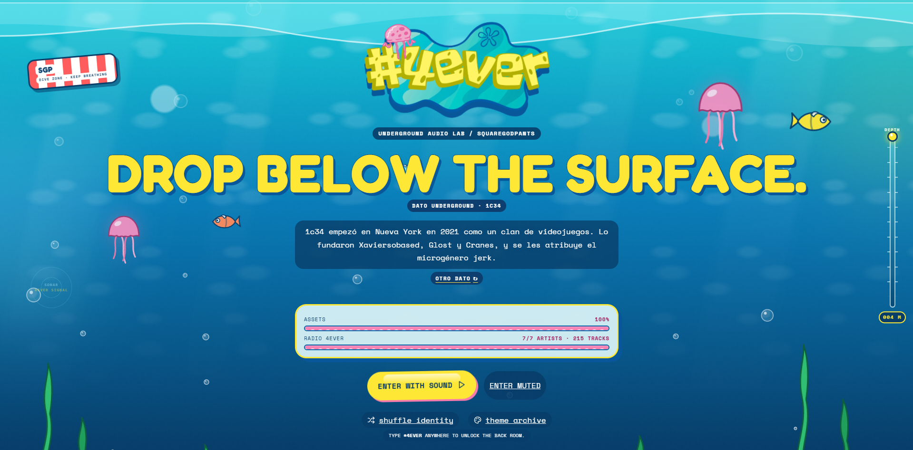
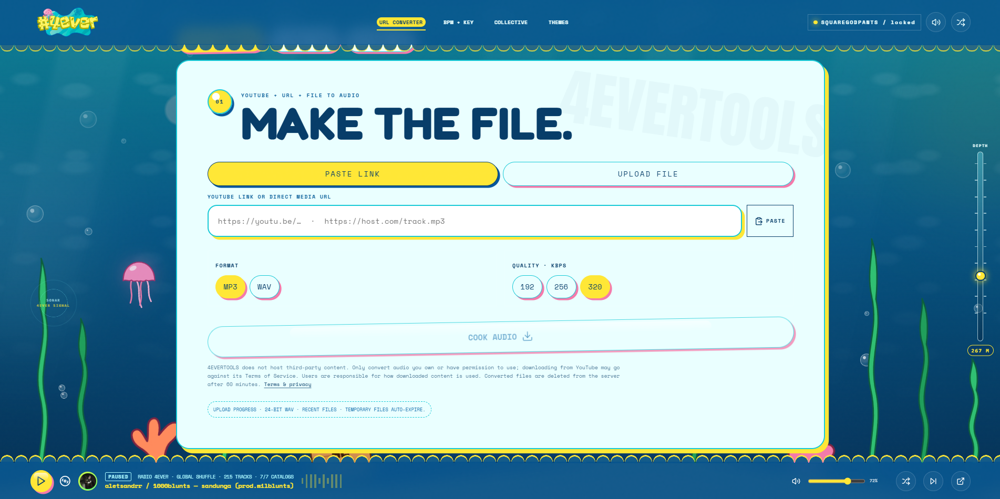
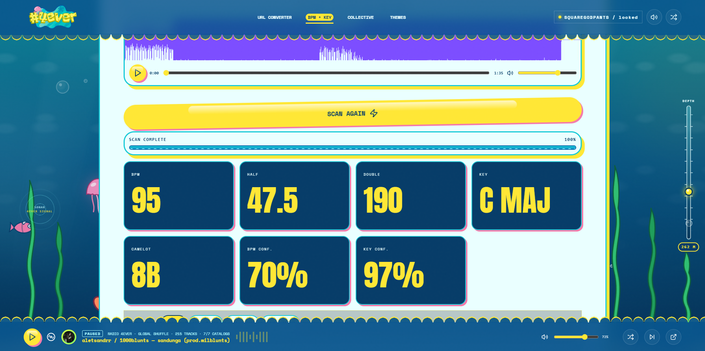
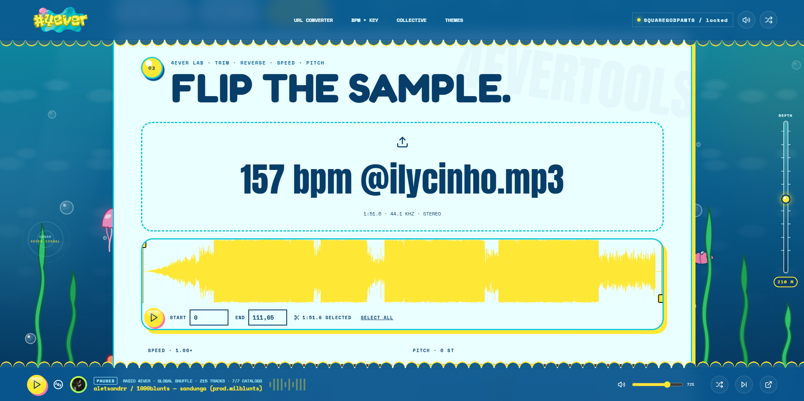

# 4EVERTOOLS

Herramientas de audio del colectivo **4EVER**. Son gratis y no piden cuenta.

## Convertir y descargar audio

Convierte un link de YouTube, un link directo a un archivo de audio o video, o un archivo propio a **MP3** o **WAV**.

1. Elige **PASTE LINK** (pega el link) o **UPLOAD FILE** (sube tu archivo).
2. Elige el formato:
   - **MP3** en 192, 256 o 320 kbps;
   - **WAV** de 16 o 24 bits.
3. Pulsa **COOK AUDIO** y espera la barra de progreso.
4. Pulsa **DOWNLOAD FILE**.

- Antes de subir un archivo ves cuánto pesa.
- Las etiquetas del original (artista, título) se conservan.
- En **RECENT FILES** quedan tus últimas conversiones mientras sigan disponibles.
- Los archivos se borran del servidor a la hora.

## BPM + KEY

Detecta el tempo y la tonalidad de un tema.

1. Arrastra una canción o un loop.
2. Si quieres, elige el **BPM RANGE** del género. Ayuda a decidir entre half-time y double-time.
3. Obtienes:
   - **BPM** exacto y otros tempos posibles;
   - **KEY** con su código Camelot;
   - **MIXES WITH**: las tonalidades que mezclan bien con esa;
   - **TUNING**: si el tema no está afinado en 440 Hz.

El análisis ocurre en tu navegador: el audio no se sube.

## 4EVER LAB

Edita un sample, loop o tema (MP3, WAV, FLAC, M4A u OGG) directo en el navegador.

- **Recortar:** elige la parte que quieres con **START / END** sobre la onda.
- **REVERSE:** da vuelta el audio.
- **SPEED:** cambia la velocidad. Con **KEEP PITCH** el tono se mantiene; con **TAPE** sube o baja junto con la velocidad, como una cinta.
- **TARGET BPM:** lleva el audio a un BPM exacto.
- **PITCH:** sube o baja el tono hasta ±12 semitonos.

Pulsa **RENDER** para escuchar el resultado. Antes de procesar, ves qué BPM y tonalidad tendrá. Para guardarlo:
- **DOWNLOAD WAV** lo descarga en WAV de 16 o 24 bits;
- **MAKE AN MP3** lo pasa al conversor para sacarlo en MP3.

Todo se procesa en tu navegador. No se sube nada.
